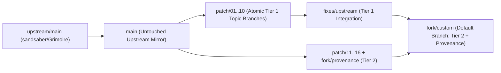

# Grimoire Fork Architecture (`mattipt/Grimoire`)

This repository is a custom fork of **[sandsaber/Grimoire](https://github.com/sandsaber/Grimoire)** (by Michael Makarov). It separates provider-neutral, upstream-PR-ready fixes from Antigravity CLI and personal workflow enhancements so upstream updates rebase cleanly and individual fixes can be opened as isolated Pull Requests.

## Branch Structure



- **`main`**: Fast-forward mirror of `upstream/main`. Never receives custom commits.
- **`fixes/upstream`**: Provider-neutral bug fixes and general UI/rendering improvements suitable for upstream PRs.
- **`fork/custom`**: Default branch consumed for BRAT releases, layering Antigravity CLI workflow improvements, full-width assistant prose layout, and `fork/provenance` (`manifest.json`, `README.md`, `FORK.md`, About links, and `-fork.<N>` release support).
- **`patch/01`–`patch/16`**: Standalone single-concern topic branches so every fix can be inspected or opened as a clean, isolated PR against `sandsaber/Grimoire:main`.

## Patch Inventory

### Tier 1 — Provider-Neutral Upstream Candidates (`fixes/upstream`)

| Branch | Base | Summary | Upstream PR Ready |
| --- | --- | --- | --- |
| `patch/01-acp-load-session-replay-guard` | `main` | Suppress `session/load` history replay notifications during active ACP runs | Yes |
| `patch/02-optimistic-user-bubble-and-turn-order` | `main` | Render user message bubbles optimistically on submit and update in place when coordinator commits | Yes |
| `patch/03-preserve-streaming-autoscroll` | `main` | Preserve streaming auto-scroll when DOM height grows during generation | Yes |
| `patch/04-stable-scrollbar-gutter` | `main` | Reserve `scrollbar-gutter: stable` and 6px quiet scrollbar track during streaming auto-follow | Yes |
| `patch/05-slash-command-ranking` | `main` | Rank exact and prefix slash-command matches ahead of substring/alphabetical order | Yes |
| `patch/06-multi-option-permission-mode-toggle` | `main` | Provider-neutral multi-option permission toggle contract across core, storage, toolbar, and tab sync | Yes |
| `patch/07-open-links-in-main-editor` | `main` | Route vault links/files to `rootSplit`, switch to existing open tabs, reuse active tab on click, and open new tab on `Cmd/Ctrl+Click` | Yes |
| `patch/08-markdown-table-cell-wrapping` | `main` | Render markdown tables at full message width with natural cell text wrapping | Yes |
| `patch/09-dataview-inline-formula-guard` | `main` | Guard inline `=` and `$=` code spans against Dataview inline-query parsing errors | Yes |
| `patch/10-windowed-step-folding` | `main` | Scrollable recent-steps window (last few vs. show all) for intermediate steps + `enableStepFolding` Display setting | Yes |

### Tier 2 — Antigravity & Fork Workflow Customizations (`fork/custom`)

| Branch | Base | Summary |
| --- | --- | --- |
| `patch/11-antigravity-five-work-modes` | `patch/06-multi-option-permission-mode-toggle` | Expose all 5 `agy acp` work modes (`default`, `accept-edits`, `auto`, `plan`, `full_access`) |
| `patch/12-antigravity-workflows-root` | `main` | Discover flat `.agents/workflows/*.md` files ahead of `.claude/skills` and `.agents/skills` |
| `patch/13-agy-background-continuation` | `main` | Add `noteTurnEnded` streaming hooks and poll Antigravity transcripts for background commands and subagent wakeups after `end_turn` |
| `patch/14-full-width-assistant-layout` | `main` | Allow assistant prose blocks to expand to full message width (`max-width: 100%`) |
| `patch/15-antigravity-hide-parallel-workers` | `main` | Hide the ineffective Parallel workers toggle and clear `orchestratorMode` when the active provider is Antigravity |
| `patch/16-user-message-chat-bubble` | `main` | Style user messages as distinct rounded light-blue chat bubbles with border and subtle elevation |
| `fork/provenance` | `main` | Fork identity (`manifest.json`, `README.md`, `FORK.md`, Settings → About links), `sync-fork-stack.sh`, and `-fork.<N>` release metadata support |

## Syncing with Upstream

1. Fetch upstream and fast-forward `main`:
   ```bash
   git fetch upstream
   git checkout main
   git merge --ff-only upstream/main
   ```
2. Rebase each independent `patch/*` branch (and `fork/provenance`) onto `main` (and `patch/11` onto `patch/06`), dropping any commit upstream has already merged.
3. Rebuild `fixes/upstream` and `fork/custom`:
   ```bash
   bash scripts/sync-fork-stack.sh
   ```

## Cutting a BRAT Release

For incremental fork releases between upstream versions, use `-fork.<N>` versioning (e.g., `2.0.14-fork.1`) so BRAT detects updates automatically across vaults:

1. Ensure `fork/custom` is checked out and `npm run lint`, `npm run typecheck`, `npm run test -- --selectProjects unit`, `node scripts/check-release-metadata.mjs`, and `npm run build:release` pass.
2. Update `package.json` version (e.g., `2.0.14-fork.1`), run `npm install --package-lock-only` + `npm run version`, and commit on `fork/custom` (or `fork/provenance` before restacking).
3. Tag the release commit with the exact `manifest.json` version (e.g., `2.0.14-fork.1`) and push `fork/custom` + tag to `origin`. GitHub Actions `.github/workflows/release.yml` builds, attests, and publishes `main.js`, `manifest.json`, and `styles.css`.
